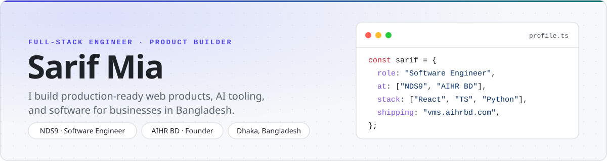
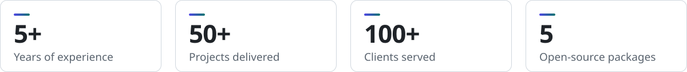
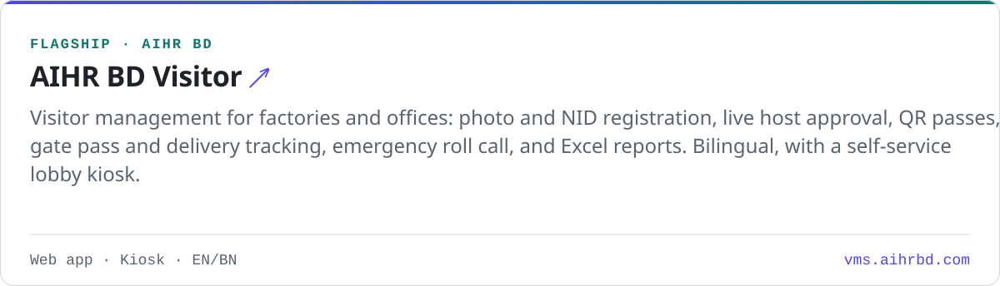
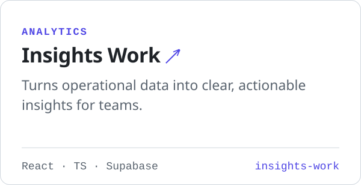
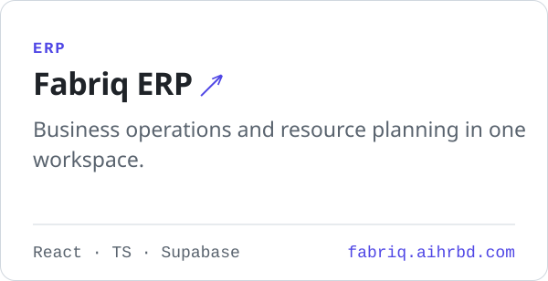
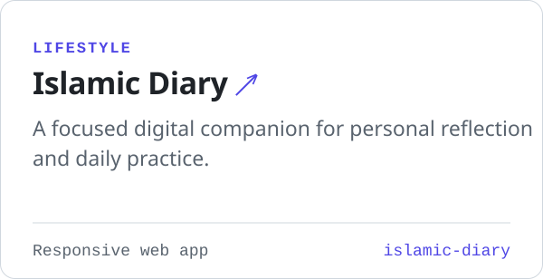
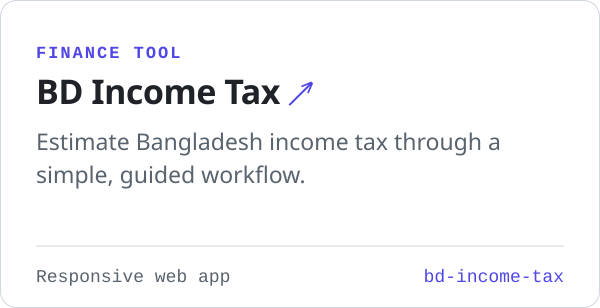

<a href="https://sarif.aihrbd.com">
	<picture>
		<source media="(max-width: 600px) and (prefers-color-scheme: dark)" srcset="assets/header-mobile-dark.svg" />
		<source media="(max-width: 600px)" srcset="assets/header-mobile-light.svg" />
		<source media="(prefers-color-scheme: dark)" srcset="assets/header-dark.svg" />
		
	</picture>
</a>

<p align="center">
	<a href="https://sarif.aihrbd.com"></a>
	<a href="https://www.linkedin.com/in/sarif-mia/"></a>
	<a href="mailto:sarifmia.ofc@gmail.com"></a>
	<a href="#open-source"></a>
</p>

## About

I'm a full-stack software engineer with **5+ years** of experience designing, building, and shipping web applications, from the first product decision to production and beyond. I care about reliable systems, clear interfaces, and work that moves real business numbers.

### Now

- Software Engineer at **[NDS9](https://nds9.co)** <sub>since 2022</sub>
- Founder of **[AIHR BD](https://aihrbd.com)** <sub>since 2024</sub>
- Maintaining open-source Python tools for Bangladesh

### What I do

- **Product engineering:** web apps, APIs, and integrations
- **Experience design:** clear, accessible interfaces
- **Growth and quality:** performance optimization and SEO

<picture>
	<source media="(max-width: 600px) and (prefers-color-scheme: dark)" srcset="assets/stats-mobile-dark.svg" />
	<source media="(max-width: 600px)" srcset="assets/stats-mobile-light.svg" />
	<source media="(prefers-color-scheme: dark)" srcset="assets/stats-dark.svg" />
	
</picture>

## Tech Stack

<picture>
	<source media="(max-width: 600px)" srcset="https://skillicons.dev/icons?i=react%2Cnextjs%2Cts%2Cjs%2Ctailwind%2Cnodejs%2Cpy%2Cdjango%2Cpostgres%2Csupabase%2Cmongodb%2Credis%2Cfigma%2Cps%2Cai&perline=8" />
	
</picture>

<sub>Also: React Native · Shopify and Liquid · MCP servers and LLM tool integration · system design · API integration · performance optimization · SEO</sub>

## Featured Products

<a href="https://vms.aihrbd.com">
	<picture>
		<source media="(max-width: 600px) and (prefers-color-scheme: dark)" srcset="assets/cards/vms-mobile-dark.svg" />
		<source media="(max-width: 600px)" srcset="assets/cards/vms-mobile-light.svg" />
		<source media="(prefers-color-scheme: dark)" srcset="assets/cards/vms-dark.svg" />
		
	</picture>
</a>

<p>
	<a href="https://insights-work.vercel.app"><picture><source media="(prefers-color-scheme: dark)" srcset="assets/cards/insights-dark.svg" /></picture></a>
	<a href="https://fabriq.aihrbd.com"><picture><source media="(prefers-color-scheme: dark)" srcset="assets/cards/fabriq-dark.svg" /></picture></a>
	<a href="https://islamic-diary.vercel.app"><picture><source media="(prefers-color-scheme: dark)" srcset="assets/cards/diary-dark.svg" /></picture></a>
	<a href="https://bd-income-tax-calculator.vercel.app"><picture><source media="(prefers-color-scheme: dark)" srcset="assets/cards/tax-dark.svg" /></picture></a>
</p>

## Open Source

Python packages for Bangladesh-specific problems. All MIT-licensed, tested, and free to use.

### [bangladesh-mcp](https://github.com/sarif-mia/bangladesh-mcp) 

MCP server that gives AI assistants (Claude, Cursor, VS Code) Bangladesh tools: income tax, taka in words, mobile number checks, EMI and savings.

```bash
uvx --from git+https://github.com/sarif-mia/bangladesh-mcp bangladesh-mcp
```

### [bd-income-tax](https://github.com/sarif-mia/bd-income-tax) <a href="https://pypi.org/project/bd-income-tax/"></a>

Individual income tax with NBR bands, taxpayer categories, investment rebate, minimum tax, Bangla output and a CLI.

```bash
pip install bd-income-tax
```

### [bdkit](https://github.com/sarif-mia/bdkit) <a href="https://pypi.org/project/bdkit/"></a>

Taka amounts in words (English and Bangla, lakh/crore), mobile number validation with operator detection, Bangla digits.

```bash
pip install bdkit
```

### [scientific-calculator](https://github.com/sarif-mia/scientific-calculator) <a href="https://pypi.org/project/scientific-calculator-v1/"></a>

Scientific calculator for Python and the terminal with safe expression evaluation and an interactive mode.

```bash
pip install scientific-calculator-v1
```

### [mini-toolkit](https://pypi.org/project/streamlit-mini-toolkit/) <a href="https://pypi.org/project/streamlit-mini-toolkit/"></a>

25 everyday image, document, text and web utilities in one Streamlit app.

```bash
pip install streamlit-mini-toolkit
```

## Client Work

Websites I have built or worked on:

<p>
	<a href="https://lovegen.com"></a>
	<a href="https://lvgn.com"></a>
	<a href="https://dunamiss.in"></a>
	<a href="https://dunacare.in"></a>
	<a href="https://nds9.co"></a>
</p>

## Let's Work Together

I'm open to freelance projects, product collaborations, and engineering roles. Email is the fastest way to reach me, and I usually reply within a day.

<p>
	<a href="mailto:sarifmia.ofc@gmail.com"></a>
	<a href="https://www.linkedin.com/in/sarif-mia/"></a>
	<a href="https://sarif.aihrbd.com"></a>
</p>
